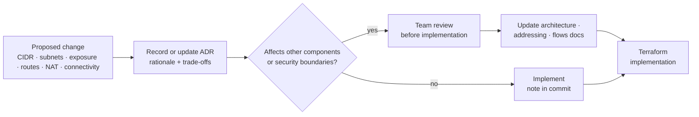

# VitalGov Architecture Decision Log

*Part of the [VitalGov Cloud Infrastructure documentation set](README.md). Related: [aws-architecture.md](aws-architecture.md) · [ip-addressing-plan.md](ip-addressing-plan.md) · [network-traffic-flows.md](network-traffic-flows.md)*

**Purpose:** This document records the important architectural decisions made during the design of the VitalGov AWS network. It explains not only what was selected, but also why it was selected, what trade-offs it introduces and what still needs to be confirmed.

The log will be updated when the team approves the design or makes a material change.

---

## ADR-001: AWS Region (drafted 12 Oct 2026)

**Decision:** Use Africa (Cape Town), `af-south-1`, for in-scope AWS resources.

**Reason:** The project brief (`project.md`) mandates `af-south-1` as the deployment region, non-negotiable, for every AWS resource.

**Scope note (corrected 12 Oct 2026, issue I-004):** The brief contains two distinct requirements that must not be conflated: the National Health Act requires patient data never to leave Nigerian soil, *and* the brief specifies `af-south-1` (South Africa) as the required deployment region. This ADR records the **region choice only** - selecting `af-south-1` does not by itself demonstrate NHA residency compliance. The residency interpretation, enforcement position (residency middleware, 403 + NHA alerting) and any exception documentation are owned by the security team in D1 and must be countersigned at the four-discipline review.

**Follow-up:** Confirm service availability in the selected Region; security team to countersign the residency wording before this ADR is treated as approved.

**Superseded in part by ADR-012 (12 Oct 2026):** the region choice is now subject to the residency posture: capstone demo in `af-south-1` with synthetic data (Option C), production design toward a Nigeria-side patient-data boundary (Option A), pending sponsor/legal approval (I-017).

**Status:** Region selected as project requirement; residency posture per ADR-012; countersign pending; implementation verification pending.

---

## ADR-002: Two Availability Zones (drafted 12 Oct 2026)

**Decision:** Design the VPC to span two Availability Zones.

**Reason:** Two AZs provide a practical balance between resilience and the scope of the capstone.

**Trade-off:** Two AZs do not provide regional disaster recovery. Services must also be configured to use both AZs appropriately for the design to deliver its intended resilience.

**Status:** Selected for the current design.

---

## ADR-003: VPC CIDR (drafted 12 Oct 2026)

**Decision:** Propose `10.20.0.0/16` for the VPC.

**Reason:** The address space leaves room for multiple subnet tiers and future expansion.

**Trade-off:** The address space is larger than the immediate capstone may need.

**Follow-up:** Check for overlap with existing networks and confirm application subnet sizing before implementation. *(Sizing recommendation drafted; see [ip-addressing-plan.md](ip-addressing-plan.md) §6, issue I-009.)*

**Status:** Proposed; implemented in the Terraform (`Networking/` module), countersign at the four-discipline review.

---

## ADR-004: Public ALB and private EC2 instances (drafted 12 Oct 2026)

**Decision:** Use an internet-facing ALB for public HTTPS entry and run application instances in private subnets.

**Reason:** This separates the public entry point from the application compute layer and limits direct exposure of EC2 instances.

**Follow-up:** Confirm the client access requirements, target ports and health checks.

**Listener certificate (15 Oct 2026):** The ALB terminates HTTPS :443 with an ACM certificate. Before the team's free DNS domain is validated, Terraform generates a self-signed certificate and imports it to ACM, so HTTPS works from the first deploy (browsers warn; the test client skips verification). When `domain_name` is set to the free DNS domain, the ACM DNS-validated certificate replaces it automatically; the validation CNAME is added manually at the DNS provider because the zone is not in Route 53.

**Status:** Selected for the current design.

---

## ADR-005: One shared NAT gateway (drafted 12 Oct 2026)

**Decision:** Use one NAT gateway in a public subnet in AZ 1.

**Reason:** A single gateway reduces the number of NAT gateways required and helps control the capstone's infrastructure cost.

**Trade-off:** NAT-based outbound connectivity depends on the gateway and AZ 1. Workloads in AZ 2 may also incur cross-AZ transfer charges.

**Mitigation:** Use VPC endpoints for supported AWS service traffic and avoid unnecessary internet egress. Document the availability limitation.

**Status:** Selected for the current design; cost and risk review pending. *(Risk formalised in ADR-010.)*

---

## ADR-006: VPC endpoints (drafted 12 Oct 2026)

**Decision:** Use VPC endpoints for supported AWS services where required.

**Reason:** Private connectivity can reduce reliance on NAT for AWS service access and supports a more restricted network design.

**Documented exception - CloudTrail (issue I-005):** The brief requires VPC endpoints for every AWS service the platform calls and lists CloudTrail. AWS provides no VPC endpoint for CloudTrail. Private workloads will therefore reach the in-region CloudTrail API endpoint via the shared NAT gateway; log files are delivered to S3 through the S3 gateway endpoint. Traffic remains within `af-south-1`. This is a deliberate, documented deviation and requires security-team approval before deployment.

**Log-file validation (brief non-negotiable):** CloudTrail is configured with **log-file validation enabled** (`enable_log_file_validation = true` in the Observability Terraform module), so the digest files delivered alongside each log file allow post-delivery tampering to be detected. This satisfies the brief's "CloudTrail with log file validation" requirement independently of the endpoint exception above.

**Follow-up:** Endpoint inventory drafted in [aws-architecture.md](aws-architecture.md) §4.7; confirm each service, endpoint type, endpoint policy, security-group rule and route-table association.

**Endpoint set decision (15 Oct 2026, issue I-027):** The implemented inventory is the S3 gateway endpoint plus KMS, Secrets Manager and SSM/SSMMessages interface endpoints, placed in AZ 1 (`endpoint_az_count = 2` restores dual-AZ placement). CloudWatch, ECR and ECS traverse the shared NAT gateway instead of interface endpoints, saving about $45/month and keeping the environment under the $200 budget alarm. EC2Messages is omitted because AL2023 uses SSMMessages. This is a deliberate deviation from the brief's "VPC endpoints for every AWS service" line and requires security-team approval at the four-discipline review.

**Status:** Implemented per the endpoint set decision above; CloudTrail and endpoint-set exceptions pending security approval.

---

## ADR-007: Dedicated PKI subnet tier (drafted 12 Oct 2026)

**Decision:** Reserve subnet CIDRs for PKI/CA services, subject to confirmation of the final service placement.

**Reason:** A dedicated network boundary can make CA access restrictions and documentation easier to manage.

**Trade-off:** A dedicated subnet alone does not secure the CA or provide high availability.

**Follow-up:** Confirm the CA software, its OCSP requirements, signing-key protection and recovery design with the PKI owner. *(Blocked, issue I-007.)*

**Status:** Proposed; implementation details pending.

---

## ADR-008: Application compute model (drafted 12 Oct 2026)

**Decision (proposed):** Run the application services (Keycloak, API gateway, VitalGov API) on **Amazon ECS** in private subnets, consistent with the brief's tool stack (`project.md`: "AWS af-south-1 (ECS, RDS, ...)"); retain **EC2** for the PKI/CA tier, which the brief explicitly places on EC2 ("Smallstep CA or EJBCA Community on EC2 in af-south-1").

**Reason:** The brief's tool stack is the authoritative scope statement. The original design text in this document set described a pure-EC2 application tier, which conflicts with it (issue I-002).

**Trade-off / follow-up:** ECS implies task-based networking (awsvpc mode recommended so tasks get their own ENIs and security groups), plus ECR and ECS/STS interface endpoints added to the endpoint inventory. Subnet sizing in [ip-addressing-plan.md](ip-addressing-plan.md) §6 must count tasks, not instances.

**Launch-type recommendation (13 Oct):** **Fargate** for the app tier (Keycloak, API gateway, VitalGov API); no instance management in a nights-only timeline, and Keycloak session state lives in RDS (ADR-009) so tasks are replaceable. **EC2 remains** for the CA tier (brief-mandated, persistent) and the **ops tier** - a single host running the `tailscaled` and Wazuh agent daemons (ADR-013).

**Status:** Proposed; implemented as Fargate in the Terraform (`Ecs/` module), countersign at the four-discipline review.

---

## ADR-009: Database deployment model (drafted 12 Oct 2026)

**Decision (proposed):** Use **Amazon RDS for PostgreSQL 15** in the private data subnets, KMS-encrypted, no public accessibility, security-group-restricted to the application tier only, automated backups retained per the period required by the National Health Act (value pending from security team, issue I-011).

**Reason:** The brief's tool stack specifies RDS and PostgreSQL 15; the original document left the database technology open (issue I-003). RDS removes self-managed database patching/backup work from a 3-night window and keeps data at rest in `af-south-1` under KMS.

**Trade-off:** Multi-AZ RDS doubles database cost; propose Single-AZ for the capstone with documented risk; upgrade to Multi-AZ if budget allows. Backups land in S3 within the region (gateway endpoint).

**Follow-up:** DevOps/Security confirmation at review; retention period value from security team.

**Status:** Proposed; implemented as RDS PostgreSQL 15 Single-AZ in the Terraform (`Database/` module), countersign at the four-discipline review.

---

## ADR-010: NAT single-AZ dependency - accepted risk (drafted 12 Oct 2026)

**Decision (proposed):** Keep the single shared NAT gateway in AZ 1 for the capstone, with the availability limitation explicitly accepted and documented rather than hidden (issue I-006).

**Reason:** A second NAT gateway roughly doubles monthly NAT cost. The workloads depending on egress are not continuously internet-dependent: VPC endpoints cover AWS service traffic, OCSP stapling exists precisely to tolerate intermittent external connectivity, and clinic LDAP/SAML federation traffic is bursty.

**Risk accepted:** An AZ 1 outage takes all internet egress down for both AZs, including OCSP staple refresh, SAML metadata fetches and clinic directory reachability. Mitigation: staple cache covers short outages (duration set by security team), federation failures are retryable, and no inbound path depends on NAT.

**Follow-up:** Revisit if the security team's OCSP fallback design or external-connectivity requirements (I-007, I-010) make egress availability a hard requirement; a second NAT is a small Terraform change if decided before provisioning. *(Update 12 Oct, Night 2: I-010 flows drafted, F10–F14 confirm federation egress is bursty and fail-closed for new logins only, so the single-NAT risk profile is unchanged; decision still required at review.)*

**Status:** Proposed; implemented as one NAT gateway, risk accepted pending countersign at the four-discipline review.

---

## ADR-011: Administrative access method (drafted 12 Oct 2026)

**Decision (proposed):** Use **AWS Systems Manager Session Manager** for all administrative access to EC2 instances (including CA hosts). No inbound SSH from anywhere; no public SSH as a shortcut (issue I-008).

**Reason:** Session Manager is IAM-authenticated, requires no inbound ports or bastion host, and provides session logging to CloudWatch Logs/S3, which satisfies the requirement that administrative access "must include the required IAM permissions, connectivity and logging configuration" and produces audit evidence for the NHA-mandated audit trail.

**Implementation notes:** Requires `ssm`, `ssmmessages` and `ec2messages` interface endpoints in the private subnets (already listed in the endpoint inventory), an instance profile with SSM IAM permissions, and OS-level agent availability on the AMI chosen.

**Trade-off:** Adds three interface endpoints (small hourly cost); breaks if endpoints or IAM policy are misconfigured; covered by validation item 9 in [network-traffic-flows.md](network-traffic-flows.md).

**Status:** Proposed; implemented as Session Manager in the Terraform (`Ops/` module), countersign at the four-discipline review.

---

## ADR-012: Data residency posture (drafted 12 Oct 2026)

**Decision (proposed):** Run the capstone deployment entirely in `af-south-1` using **synthetic
patient data** (Option C), while designing toward a **split architecture** that keeps
patient-identifiable data, backups and raw audit events on Nigerian soil for production
(Option A). Any production or "compliant" claim is gated on documented sponsor and
Nigerian legal/privacy approval (Option B track, issue I-017).

**Reason:** project.md mandates `af-south-1` for every AWS resource *and* states patient data
never leaves Nigerian soil. AWS has no Nigerian region, so both cannot hold for real data. Option
C satisfies the brief's region mandate and keeps every business-requirement test demonstrable
(three federation runs, 403 residency test, offboarding SLA, Wazuh evidence) while bounding the
compliance claim honestly. Full reasoning: the residency analysis (team document).

**Data-class classification (adopted for design, countersign requested at review):**

| Data class | Cross-border | Conditions |
|---|---|---|
| Patient records (PHI) | **No** | Nigerian soil only, storage, caches, working sets |
| Backups / snapshots / DR | **No** | Same constraint as primary storage |
| Raw audit logs | **No, as-is** | Redact/tokenize in-country or sink SIEM (Wazuh) in Nigeria |
| Identity attributes | Conditional | Pseudonymous IDs and role claims OK; full profiles need NDPA safeguards |
| Tokens (JWT) | Conditional yes | ≤10 min TTL, no patient payloads, never logged raw (`licence_number`/`clinic_id` = personal data) |
| Telemetry / metrics | Yes, sanitized | No patient/clinic IDs in metric labels or route paths |
| Alerts (Slack / compliance) | Conditional | Practitioner + NHA section only, minimize per event |
| Certificates / CA material | Conditional | Public certs/OCSP fine; private keys under KMS, key residency assessed |

**Enforcement layering (issue I-018):** the brief's country-header rejection is kept as the
demonstrable floor; trusted context (gateway-derived client IP/geolocation, validated
`data_residency_attestation` at the API, Keycloak session origin) is checked beneath it so the
header is never the sole signal.

**Trade-off:** the demo proves technical controls, not legal compliance, stated openly in the
docs rather than hidden. Option A adds a cross-site link and a Nigerian hosting dependency to the
production path; that complexity is deferred, not designed away.

**Follow-up:** sponsor + legal/privacy approval (I-017); Security countersign of the
classification table (I-019); log-field minimization at implementation; production gate checklist
in the residency analysis §7 (team document).

**Status:** Proposed; pending sponsor and legal/privacy sign-off. ADR-001 region decision is
subject to this posture.

---

## ADR-013: Clinic connectivity and the Tailscale overlay (drafted 13 Oct 2026)

**Decision (proposed):** adopt the **hybrid** posture:

| Layer | Mechanism |
|---|---|
| Clinic users/devices → platform | Public ALB over HTTPS + **mTLS client certificates** (VitalGov CA) + stapled OCSP, unchanged (brief's device-trust layer) |
| Federation (Keycloak → clinic LDAP/SAML) | **Tailscale overlay in the capstone**, a single ops-tier EC2 acts as Tailscale subnet router to the lab clinic directory; NAT + egress allowlist registry (F10–F14) remains the production/real-clinic mechanism |
| Log ingestion (Wazuh) | The **same ops host** runs the Wazuh agent + Tailscale client (owned by Ismail) → Wazuh manager over the tailnet, flow F15 |
| AWS services | VPC endpoints (ADR-006), no change |

**Reason:** the other discipline's environment reaches the lab identity systems (Samba AD/LDAP,
Keycloak) and the Wazuh manager over a Tailscale network. The lab directory has no public LDAPS
endpoint, exposing an AD DC to the internet would be a review finding, and without the overlay
the LDAP federation evidence run cannot execute at all. Conversely, the clinic **user/device**
path must stay the ALB + mTLS + OCSP layer: Tailscale there would bypass the D4 device-trust
evidence, cannot onboard 200 clinics, and would create a second ingress path. Server-to-server
plumbing (federation binds, sanitized log events) carries no user and no patient record, so the
private overlay is appropriate for it.

**Scope guard:** Tailscale is **not** an ingress path for users, devices or patient records; it
changes none of the brief's components, tool stack or evidence requirements. In the production
design (ADR-012 Option A) federation returns to NAT + allowlist against real clinic endpoints
and the tailnet layer is retired.

**Residency note:** tailnet traffic is WireGuard-encrypted but may transit Tailscale
coordination/DERP infrastructure outside Nigeria, acceptable under Option C (synthetic data
only); recorded as a consideration for the production gate (I-017/I-019).

**Trade-off:** the single ops host is a single point of failure for capstone federation and
Wazuh ingestion; lab connectivity depends on the tailnet being up. Both limits are capstone-only
by construction.

**Follow-up:** Security + DevOps confirmation at review; a **fresh tagged tailnet auth key**
required before connector configuration (I-023); production posture returns to F10–F14.

**Status:** Proposed; implemented as the single ops host in the Terraform (`Ops/` module), decision at the four-discipline review (re-booked after 13 Oct, issue I-012).

---

## ADR-014: GitHub Actions OIDC deploy role (decided 15 Oct 2026)

**Decision:** CI authenticates to AWS through the existing OIDC provider
(`token.actions.githubusercontent.com`) and one deploy role,
`vitalgov-production-github-actions`, held to two limits: only protected branches of this
repository may assume it, and the policy keeps no account-wide mutating grant.

| Control | Setting |
|---|---|
| Who may assume | `ref:refs/heads/cloud` and `ref:refs/heads/main` only, in both token formats (`org/repo` and `org@id/repo@id`) |
| Audience | `sts.amazonaws.com` only |
| EC2 | describe and tag actions; no `RunInstances`, no VPC, subnet, route or security-group mutation |
| IAM | `iam:PassRole` on the two ECS roles only; no `CreateRole`, `PutRolePolicy`, `AttachRolePolicy` |
| KMS | no account-wide `PutKeyPolicy`, `GetKeyPolicy`, `ScheduleKeyDeletion`; alias actions scoped to `alias/vitalgov-*` |
| CloudTrail, budgets, SNS | read-only, with `sns:Publish` retained for budget alerts |
| ECS | 8 deployment actions rather than `ecs:*` |
| Destructive data actions | none: `DeleteBucket`, `DeleteDBInstance`, `DeleteLogGroup`, `DeleteLoadBalancer`, `DeleteRepository` are all absent |

**Reason:** the role is assumed by automation, so a leaked token is the whole blast radius.
The first version trusted any ref in the repository and granted `Resource = "*"` across
`ec2:*`, `kms:*`, `cloudtrail:*` and `budgets:*` (issue I-030). Branch pinning keeps a
compromised workflow, a forked pull request or a stray feature branch out of the production
account entirely, and the trimmed policy limits what a valid token can do once inside.

**Implementation notes:** two actions stay on `Resource = "*"` because AWS will not
resource-scope them: `ecr:GetAuthorizationToken` and `ecs:DeregisterTaskDefinition`. The
provider thumbprint is the SHA-1 of ISRG Root X1, the anchor of the chain the GitHub OIDC
endpoint currently serves; the earlier DigiCert hashes no longer matched that chain. Full
`terraform apply` continues from the admin profile, because the role deliberately cannot
create EC2, VPC, ALB, RDS, CloudTrail or SNS resources: CI is a deploy-and-verify path, not
an infrastructure-build path.

**Trade-off:** CI cannot apply the whole stack. If that becomes wanted, split the role into
a read/verify role and a scoped infrastructure changer instead of widening this one.

**Status:** Applied and verified 15 Oct 2026 (issue I-030; OIDC smoke run 38793657035).

---

## Decisions register before provisioning

The stack was applied on 15 Oct 2026 (166 resources) and `terraform plan` reports
`No changes`. Owners bring their row to the four-discipline review (issue I-012) as the
record of what was settled before that apply; unresolved rows may be deferred there with
an owner and date.

| Decision | Options | Owner | Current proposal | Settle by |
|---|---|---|---|---|
| Residency posture | A split / B approval / C synthetic | Sponsor + Security + counsel | **C now, design toward A (ADR-012)** | Before any data loading |
| Clinic connectivity + lab overlay | A NAT+allowlist / B Tailscale / C hybrid | Cloud + Security + DevOps | **Hybrid (ADR-013)** (ALB mTLS for clinic users; tailnet for lab federation + Wazuh) | At review |
| Compute model | EC2 vs ECS | DevOps + Cloud | ECS for apps, EC2 for CA (ADR-008) | Before apply |
| Database | RDS vs self-managed | DevOps + Cloud | RDS PostgreSQL 15, Single-AZ (ADR-009) | Before apply |
| Admin access | SSM vs bastion vs SSH | Cloud + Security | Session Manager (ADR-011) | Before apply |
| CI deploy-role trust | A any ref / B any branch / C protected branches | Cloud | **Protected branches only, least privilege (ADR-014)** | Resolved in code; confirm at review |
| NAT strategy | 1 vs 2 gateways | Cloud + Security | Single NAT, risk accepted (ADR-010) | At review |
| CA software + staple age/fallback | Smallstep vs EJBCA | Security; **Ismail implements** (Cloud PKI) | Open, issue I-007 | Before gateway config |
| Residency trust model | header-only vs layered | Security + DevOps | Layered (ADR-012 / I-018) | Before API/gateway work |
| Log retention period (NHA) | value required | Security | Open, issue I-011 | At review |
| SAML test IdP | add container vs AWS-only test | DevOps | Open, issue I-016 | At review |
| Subnet sizing | /20 vs /24 | Cloud + team | **/24 - applied in Terraform** (ip-addressing-plan §6; resized from /20, I-009) | Resolved in code; confirm at review |
| External clinic connectivity | allowlist + egress design | Cloud + Security | Flows F10–F14 + registry allowlist drafted, issue I-010 | At review |

## Open decisions

The following items remain open:

- ~~Database deployment model and Multi-AZ configuration.~~ → **proposed in ADR-009** (pending confirmation)
- CA and OCSP implementation. *(issue I-007, security/PKI owner)*
- ~~Approved administrative access method.~~ → **proposed in ADR-011** (pending approval)
- Final endpoint list and endpoint placement. *(draft inventory, aws-architecture.md §4.7)*
- ~~Final application subnet sizing.~~ → **recommendation in ip-addressing-plan.md §6** (pending approval)
- External client connectivity requirements. *(drafted, flows F10–F14 + allowlist posture in network-traffic-flows.md §5.1; pending Security/DevOps approval - issue I-010)*
- ~~Compute model (ECS vs EC2) and its launch type.~~ → **Fargate in ADR-008, implemented in `Ecs/`** (pending countersign)
- NHA log retention period value. *(issue I-011, security team input)*
- Formal team approval of the architecture and IP addressing plan. *(issue I-012, review slot)*

## Change management

Any material change to the VPC CIDR, subnet allocation, public exposure, route tables, NAT strategy or service connectivity should be reflected in the architecture documentation.

The team should review the change before implementation where it affects other components or security boundaries.

