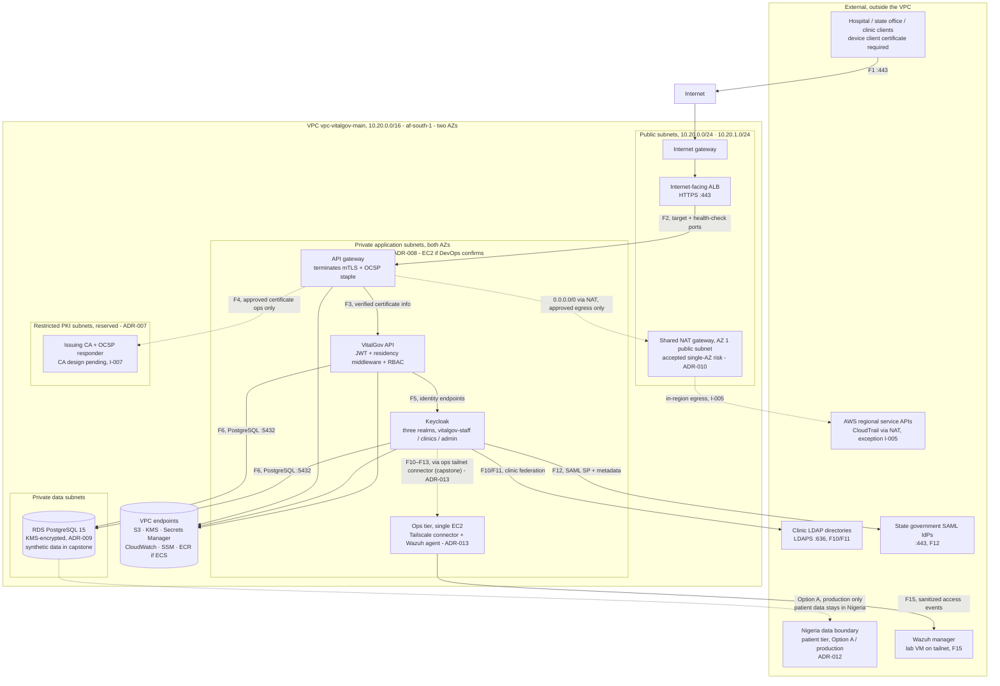

# VitalGov AWS Architecture Design

*Part of the [VitalGov Cloud Infrastructure documentation set](README.md). Related: [ip-addressing-plan.md](ip-addressing-plan.md) · [network-traffic-flows.md](network-traffic-flows.md) · [architecture-decisions.md](architecture-decisions.md)*

> **Data residency posture (ADR-012):** the capstone deployment runs entirely in `af-south-1`
> using **synthetic patient data** (Option C). Patient records, backups and raw audit events are
> bound to a Nigeria-side data boundary in the production design (Option A). See the
> residency analysis (team document) for the full argument. Until sponsor and legal/privacy
> approval are documented (I-017), this design must not be presented as production-compliant.

## 1. Purpose

This document describes the proposed AWS architecture for the VitalGov Digital Health Platform.

The purpose of this design is to provide a secure network foundation for the platform's identity services, API gateway, application services and certificate infrastructure. It defines where the main components should run and how they are expected to communicate.

The architecture is being designed before provisioning so that network boundaries, routing requirements and dependencies are understood by the team.

## 2. Architecture requirements

The design takes the following requirements into account:

- Resources that process or store in-scope health data should remain in the approved AWS Region, Africa (Cape Town), `af-south-1`, unless an exception is approved.
- External clients should access the platform through an HTTPS entry point.
- Application and data services should not be directly exposed to the public internet.
- The Certificate Authority (CA) should be accessible only through approved certificate-management workflows.
- Private workloads should use VPC endpoints to access supported AWS services where appropriate.
- The network should span two Availability Zones to reduce dependence on a single AZ.
- Infrastructure should be managed using Terraform.
- The network design should support future monitoring, security controls and infrastructure expansion.

## 3. Overall design

The proposed architecture uses one VPC spanning two Availability Zones.

Each AZ will contain a public subnet and private subnet tiers for application workloads and other services where required. The public subnets will support the internet-facing Application Load Balancer (ALB) and the shared NAT gateway. Private subnets will host the EC2-based application services.

The ALB will receive external HTTPS traffic and forward approved requests to healthy targets in the private application tier. The application services will communicate with identity, database and certificate services through explicitly permitted network paths.

VPC endpoints will provide private connectivity to supported AWS services where required. A shared NAT gateway will provide outbound internet access for private workloads that genuinely need it.

### Architecture diagram

Solid lines are flows documented in [network-traffic-flows.md](network-traffic-flows.md) (F1–F14);
dashed lines are pending designs (issue I-007, CA/OCSP details). Conditional components are
labelled with their ADR. The Nigeria node is the Option A production boundary (ADR-012), out of
scope for the synthetic-data capstone.

*If the compute model resolves to ECS (ADR-008), the application tier runs as tasks with their
own ENIs; placement inside the private application subnets is unchanged.*

## 4. Main components

### VPC

The proposed VPC CIDR is `10.20.0.0/16`. This provides address space for the initial deployment and potential future expansion.

Before implementation, the CIDR must be checked against existing institutional networks, VPN ranges and any other networks that may need to connect to VitalGov.

### Availability Zones

The design uses two Availability Zones in `af-south-1`. Actual AZ identifiers will be selected during implementation.

Public and private subnet tiers will be distributed across both AZs. Critical application services should be deployed across both AZs where the selected deployment and recovery arrangements support it.

Two AZs improve availability against an AZ-specific failure but do not provide regional disaster recovery.

### Public subnets and ALB

The public subnets will host the networking components that require public connectivity.

The ALB will provide the platform's external HTTPS entry point, subject to the team's confirmation of the public-access model. It should use subnets in both AZs and forward traffic only to approved targets.

Application instances should not require public IP addresses.

### Private application subnets

Private EC2 instances will host the platform's application services. Depending on the final deployment plan, these may include the API gateway, VitalGov API and Keycloak.

Security groups will restrict access between services. The application tier should not accept unsolicited inbound connections directly from the internet.

### Private data tier

A private data subnet tier is reserved for the database, if the team selects a database deployment that uses this arrangement.

Database access will be limited to the application components that require it. The final database technology and availability configuration remain subject to confirmation.

### PKI and certificate infrastructure

A restricted network tier is reserved for the Certificate Authority and related services if a dedicated subnet design is adopted.

Certificate issuance, renewal and revocation operations must use approved callers and explicitly permitted traffic paths. The CA must not be directly exposed to unrestricted internet access.

The existence of a second PKI subnet does not, by itself, provide CA high availability. The CA software, signing-key protection and recovery approach must be considered separately.

### VPC endpoints

VPC endpoints are used where private workloads need private AWS service access: S3 (gateway), KMS, Secrets Manager and SSM/SSMMessages (interface, AZ 1). Endpoint policies, IAM permissions and security-group rules restrict access to the intended callers.

CloudWatch, ECR and ECS traffic traverses the shared NAT gateway; see the endpoint set decision after the inventory below.

#### Endpoint inventory

Interface endpoints are placed in the private application subnet of AZ 1 (`endpoint_az_count = 1`); set `endpoint_az_count = 2` for dual-AZ placement. The reserved endpoint ranges from [ip-addressing-plan.md](ip-addressing-plan.md) §3 (`10.20.80.0/24`, `10.20.81.0/24`) are held unused should dedicated endpoint subnets be required later.

| Service | Endpoint type | Placement | Consumed by | Purpose in VitalGov |
|---|---|---|---|---|
| S3 | Gateway | Route tables of private app/data subnets | Keycloak realm backups, ALB access logs, CloudTrail log delivery | Brief: S3 for realm backups; log retention per NHA |
| KMS | Interface | Private app subnet (AZ 1) | CA tier, RDS, Secrets Manager users | Customer-managed key protecting the issuing CA key |
| Secrets Manager | Interface | Private app subnet (AZ 1) | Application services | Credentials for services and pipelines |
| CloudWatch (monitoring + logs) | **None (shared NAT)** | Egress via shared NAT | All workloads, API access-event logs | Structured log/metric shipping for Wazuh integration |
| SSM / SSMMessages | Interface | Private app subnet (AZ 1) | Admin workstations → EC2/CA nodes | Administrative access per ADR-011 (no public SSH); EC2Messages omitted (AL2023) |
| ECR | **None (shared NAT)** | Egress via shared NAT (task ENI) | ECS tasks | Container images (ADR-008) |
| ECS / STS | **None (shared NAT)** | Egress via shared NAT | ECS control plane calls | Fargate platform calls (ADR-008) |
| CloudTrail | **None available** | Egress via shared NAT, in-region endpoint | API calls to CloudTrail | **Documented exception**, see below |

**CloudTrail endpoint exception (issue I-005):** AWS provides no VPC endpoint for CloudTrail. CloudTrail API calls from private subnets traverse the shared NAT gateway to the in-region AWS endpoint; log delivery goes to S3 via the gateway endpoint. Traffic remains within `af-south-1`. This is a formal deviation from the brief's "VPC endpoints for every AWS service" line and requires security-team approval before deployment (recorded in [architecture-decisions.md](architecture-decisions.md) ADR-006).

**Log-file validation (brief non-negotiable):** CloudTrail is configured with **log file validation enabled**, so delivered log files in the S3 bucket carry digest files that allow tampering to be detected (an S3 `GetObject` against a validated digest reveals any post-delivery change). The digest files and trail logs are stored in the same af-south-1 S3 bucket and covered by the retention and encryption controls in the S3 module. Owner: Cloud Security (Ismail).

**Endpoint set decision (15 Oct 2026, issue I-027):** The implemented inventory is the S3 gateway endpoint plus KMS, Secrets Manager and SSM/SSMMessages interface endpoints in AZ 1. CloudWatch, ECR and ECS traverse the shared NAT gateway instead of interface endpoints (about $45/month saving; cost table in the terraform README). This is a deliberate deviation from the brief's "VPC endpoints for every AWS service" line, requires security-team approval at the review, and is recorded in [architecture-decisions.md](architecture-decisions.md) ADR-006. The CloudTrail exception above remains.

This inventory reflects the implemented Terraform. Changes require a plan re-run and re-review.

### NAT gateway

One NAT gateway is proposed to reduce infrastructure cost. It will be placed in a public subnet in AZ 1.

Private subnets in both AZs may route approved internet-bound traffic through this gateway. This introduces a dependency on AZ 1 for NAT-based outbound internet access and can result in cross-AZ data-transfer charges.

AWS service traffic with appropriate VPC endpoint support should use the relevant endpoint instead of the NAT gateway.

### Evidence/lab environment (non-AWS) and the ops tier (added 13 Oct - ADR-013 / I-020)

The identity evidence for this platform is first produced **outside AWS**, in the team's lab: local VMs running a Samba 4 Active Directory DC (the LDAP clinic), a standalone Keycloak (being aligned to the brief's three realms, I-022), and a Wazuh manager with agents. All lab machines are joined by a **Tailscale** overlay.

Relationship to this design: the lab is the **evidence environment, not part of the af-south-1 target deployment** (ADR-013). AWS reaches it through a single ops host in the private application subnets, administered via SSM Session Manager (ADR-011, no inbound ports):

| Host | Purpose | Owner |
|---|---|---|
| **Ops host** (`t3.small`) | One EC2 running both daemons: `tailscaled` as a subnet router (the only bridge between the VPC and the tailnet, so Keycloak reaches the lab clinic directory via F10–F13) and the Wazuh agent (ships the API's structured access events to the Wazuh manager over the tailnet, F15, ≤30 s, V18, fields sanitized per ADR-012 / I-019). Co-located because the forwarder depends on the tailnet the connector provides; production returns to NAT + allowlist | Cloud (MEMBER 1) + Ismail (Wazuh) |

The host carries no patient data in the capstone (synthetic data only, Option C). Tailnet traffic is WireGuard-encrypted but may transit Tailscale infrastructure outside Nigeria, recorded under ADR-013 as a production-gate consideration, not a capstone blocker. A **fresh tagged tailnet auth key** is required before configuration (I-023 - the exposed key is being rotated by the Tailscale admin).

## 5. Network security approach

The architecture follows a restricted-access approach:

- Public access is limited to the approved HTTPS entry point.
- Private application instances do not accept direct public internet ingress.
- Database access is restricted to approved application security groups.
- CA access is limited to authorized certificate-management components.
- Administrative access uses an approved private access method.
- Security groups provide stateful workload-level access control.
- Network ACLs may provide additional subnet-level restrictions where justified.
- Private outbound access is limited to required destinations and services.

### Administrative access detail (ADR-011, draft for implementation)

- Managed hosts (gateway, CA, ops, and any EC2-launch-type instances) carry an SSM instance
  profile; no key pairs and no inbound ports exist.
- The `ssm`, `ssmmessages` and `ec2messages` interface endpoints sit in the private subnets
  (§4.7 inventory row).
- A Session Manager preference document enables session logging to CloudWatch Logs and S3 with KMS
  encryption. Session-log retention follows the same NHA retention question as other logs
  (input pending from Security, issue I-011).
- IAM: `ssm:StartSession` scoped to instances tagged by role (`Role=CA`, `Role=Gateway`,
  `Role=Ops`); administrators use team IAM identities, not local OS users.
- CA host boundary: the SSM shell is OS administration only, certificate operations stay on the
  F4 path from the gateway (see [network-traffic-flows.md](network-traffic-flows.md) §6–§7).

## 6. Availability and cost considerations

The two-AZ design improves resilience when a service is deployed across both zones and configured to recover appropriately.

The shared NAT gateway reduces the number of NAT gateways required, but outbound internet access will be less resilient than a design with a NAT gateway in each AZ.

The team should balance availability requirements against the capstone's budget. Any single-AZ dependencies should be documented rather than hidden in the implementation.

## 7. Outstanding design decisions

The following items require confirmation before the design is treated as approved:

1. The exact external connectivity requirements for hospitals, health offices and clinics. *(drafted, flows F10–F14 and egress posture in network-traffic-flows.md §5.1; allowlist registry owner pending Security/DevOps - issue I-010)*
2. The database technology and deployment model. *(proposed, ADR-009)*
3. The selected CA implementation and its availability and OCSP design. *(open, issue I-007, requires security team)*
4. The approved administrative access method. *(proposed, ADR-011)*
5. The exact AWS services that require VPC endpoints. *(draft inventory in §4.7)*
6. The final subnet sizes after reviewing workload requirements. *(recommendation in ip-addressing-plan.md §6)*
7. Whether the shared NAT gateway is acceptable for the platform's required availability. *(trade-off recorded, ADR-010)*
8. Confirmation of the Tailscale overlay posture (hybrid, ADR-013), the single ops host (Tailscale connector + Wazuh agent), and issuance of a fresh tagged tailnet key. *(issues I-020/I-021/I-023)*

## 8. Status

**Status: Implemented in Terraform and applied 15 Oct 2026; countersign at the four-discipline review (issue I-012).**

This document describes the deployed architecture. The stack was applied on 15 Oct 2026 (166 resources). Connectivity validation and security testing are still outstanding and are tracked as the validation items in [network-traffic-flows.md](network-traffic-flows.md).
