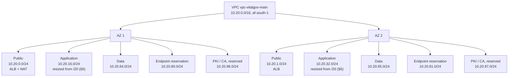

# VitalGov IP Addressing Plan

*Part of the [VitalGov Cloud Infrastructure documentation set](README.md). Related: [aws-architecture.md](aws-architecture.md) · [network-traffic-flows.md](network-traffic-flows.md) · [architecture-decisions.md](architecture-decisions.md)*

## 1. Purpose

This document records the proposed IPv4 addressing scheme for the VitalGov AWS environment.

The aim is to allocate non-overlapping IP ranges to the VPC and its subnet tiers before Terraform provisioning begins. The allocation should be straightforward to maintain and leave room for future expansion.

## 2. VPC allocation

| Property | Proposed value |
|---|---|
| VPC name | `vpc-vitalgov-main` |
| AWS Region | `af-south-1` |
| VPC CIDR | `10.20.0.0/16` |
| Availability Zones | Two |
| Address family | IPv4 |
| Status | Proposed |

The VPC CIDR must be checked for overlap with existing institutional networks, VPN ranges and any planned private connectivity before implementation.

## 3. Subnet allocation

| Subnet tier | AZ 1 CIDR | AZ 2 CIDR | Intended use |
|---|---|---|---|
| Public | `10.20.0.0/24` | `10.20.1.0/24` | ALB and NAT gateway placement |
| Application | `10.20.16.0/24` | `10.20.32.0/24` | Private application workloads (ECS tasks per ADR-008), resized from `/20` per §6, applied in Terraform |
| Data | `10.20.64.0/24` | `10.20.65.0/24` | Private database tier |
| Interface endpoint reservation | `10.20.80.0/24` | `10.20.81.0/24` | Optional dedicated interface endpoint placement |
| PKI / CA | `10.20.96.0/24` | `10.20.97.0/24` | Restricted CA tier, if required |

AZ 1 and AZ 2 are logical labels. The actual AZ identifiers will be selected from the Availability Zones available to the AWS account in `af-south-1`.

### Subnet layout

*NAT gateway sits in the AZ 1 public subnet only (ADR-010). Interface endpoints are placed in the
application subnets in Terraform; the `10.20.80.0/24` and `10.20.81.0/24` ranges are held as an
unused reservation should dedicated endpoint subnets be required later.*

## 4. Address allocation rationale

The `/16` VPC provides a large address pool for the initial deployment and future growth. The public subnets use `/24` ranges, while the application subnets use `/24` ranges (right-sized from the originally proposed `/20`, see §6).

The application subnet sizes are intentionally generous in the initial proposal. They should be reviewed against the expected EC2 instance count, scaling requirements and future expansion plans before they are committed in Terraform.

The data, endpoint and PKI ranges are reserved for planning purposes. They should not automatically become separate subnet resources unless the implementation requires them.

Interface endpoints can be placed in suitable existing private subnets. S3 gateway endpoints do not require dedicated endpoint subnets.

AWS reserves five IPv4 addresses in each subnet. Therefore, the usable address count is lower than the total number represented by its CIDR.

## 5. Addressing rules

- Do not allocate overlapping subnet CIDRs within the VPC.
- Do not change an approved subnet CIDR without updating this document and informing the team.
- Check for conflicts with on-premises, VPN and other connected networks.
- Keep public-facing and private workload subnet allocations separate.
- Reserve unused address space for future needs.
- Data and PKI subnet route tables must not include a `0.0.0.0/0` route, those tiers are egress-blocked (see network-traffic-flows.md §5; validation V10).
- Use clear Terraform names that identify the VPC, environment, subnet tier and AZ.
- Applied CIDRs match this plan; subnet IDs are in the deployment inventory.

## 6. Items to confirm

Before implementation, confirm:

1. That `10.20.0.0/16` does not overlap with existing networks.
2. That `/24` application subnets (right-sized from the originally proposed `/20`) are sufficient for the expected workload. **Resolved (issue I-009); applied in Terraform.**
3. Whether dedicated data and PKI subnet tiers are required by the final service placement.
4. Whether interface endpoints will use dedicated or existing private subnets. **Resolved: placed in the application subnets in Terraform; `10.20.80.0/24` and `10.20.81.0/24` reserved (§3).**

### Application subnet sizing recommendation

Expected addressable resources in the application tier, per AZ:

| Component | Count per AZ | Notes |
|---|---|---|
| Keycloak | 2 (tasks or instances) | Two-AZ deployment |
| API gateway (mTLS/OCSP terminator) | 2 | Brief: gateway terminates mTLS |
| VitalGov API | 2 | Two-AZ deployment |
| Ops host (Tailscale + Wazuh + pipeline runners) | 1 | Consolidated ops tier (ADR-013) |
| **Estimated ENIs per AZ** | **≤ 7** | Even with 3× headroom: 21 |

A `/24` provides 251 usable addresses per AZ (AWS reserves 5), which covers the estimate with more than 30× headroom. **The application subnets were right-sized to `10.20.16.0/24` (AZ 1) and `10.20.32.0/24` (AZ 2)**; applied in Terraform (`terraform.tfvars`), with the remaining `10.20.16.0/20` to `10.20.63.255` space left unallocated for future expansion.

Rationale: smaller subnets are easier to justify in review, reduce accidental-attachment blast radius, and keep future on-premises/VPN overlap checks (item 1) simple. The change costs nothing if made before provisioning.

*Status: applied in Terraform 15 Oct 2026; countersign alongside ADR-003.*

## 7. Status

**Status: Implemented in Terraform and applied 15 Oct 2026 (8 subnets, all /24); countersign at the four-discipline review (issue I-012).**

This plan records the deployed address allocation. All eight subnets were created on 15 Oct 2026 and the live CIDRs match this plan.
