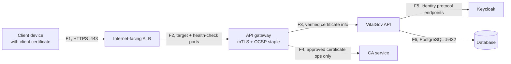
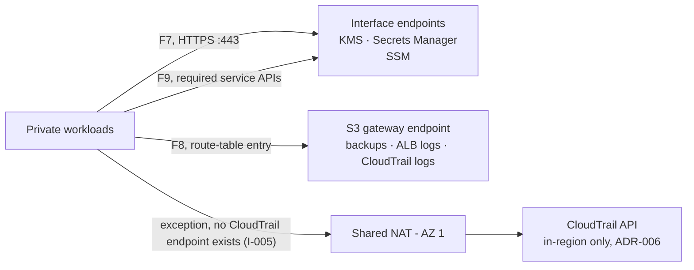
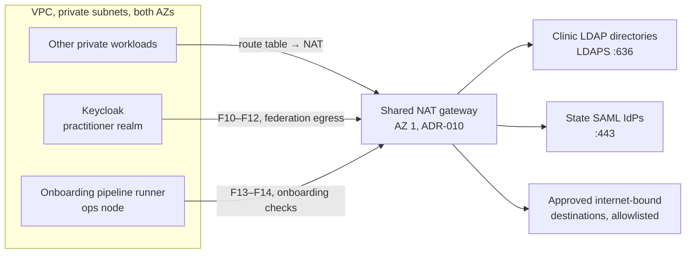
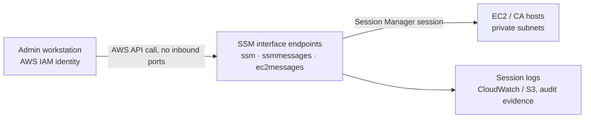

# VitalGov Network Traffic Flows

*Part of the [VitalGov Cloud Infrastructure documentation set](README.md). Related: [aws-architecture.md](aws-architecture.md) · [ip-addressing-plan.md](ip-addressing-plan.md) · [architecture-decisions.md](architecture-decisions.md)*

> **Residency note (ADR-012 / I-018 / I-019):** all flows below are intra-`af-south-1` and carry
> synthetic data in the capstone. In production, patient-identifiable content may not traverse
> these paths without the approved data-flow assessment: raw audit events with patient IDs must
> be redacted or sunk in Nigeria, and metric/log fields must be sanitized (I-019). Residency
> rejection uses the brief's country-header test plus trusted gateway context beneath it (I-018).

## 1. Purpose

This document defines the intended communication paths between external clients, the VitalGov application components and the AWS services used by the platform.

The purpose is to help the Cloud, DevOps, Security and application teams agree on which connections are required before configuring security groups, route tables and VPC endpoints.

The flows below describe the intended design. Exact application ports and service-specific requirements must be confirmed during implementation.

## 2. Inbound traffic

| Flow | Source | Destination | Intended access |
|---|---|---|---|
| F1 | Hospitals, health offices and clinics | Internet-facing ALB | HTTPS on TCP 443 |
| F2 | ALB | Private application targets | Only the configured target and health-check ports |

The ALB is the public entry point. Application instances should not accept direct inbound internet traffic.

The final ALB listener, certificate and client access policy must be confirmed before deployment.

## 3. Internal application traffic

| Flow | Source | Destination | Intended access |
|---|---|---|---|
| F3 | API gateway | VitalGov API | Configured application port |
| F4 | API gateway / authorized workflow | CA service | Approved certificate-management operations |
| F5 | Application components | Keycloak | Required identity protocol endpoints |
| F6 | API and Keycloak | Database | PostgreSQL TCP 5432, if PostgreSQL is selected |

These connections should be permitted through narrowly scoped security-group rules.

The final application ports and required communication paths will be confirmed with the relevant component owners. The CA should not accept certificate issuance requests from arbitrary application components.

### Request path (F1–F6)

*Without a valid client certificate the path stops at the gateway, a Keycloak token alone does
not reach the API (brief: device trust layer).*

## 4. AWS service access

| Flow | Source | Destination | Intended access |
|---|---|---|---|
| F7 | Private EC2 workloads | Required interface endpoints | HTTPS TCP 443 |
| F8 | Private workloads | S3 through a gateway endpoint, if selected | HTTPS using the applicable endpoint route and authorization |
| F9 | Authorized workloads | KMS and Secrets Manager (interface endpoints); CloudWatch (shared NAT, per ADR-006) | Required service APIs through supported endpoints where configured |

VPC endpoints provide private connectivity to supported AWS services. They do not replace IAM permissions, resource policies or endpoint policies.

Interface endpoints require appropriate security-group rules. Gateway endpoints use route-table configuration. The endpoint type and configuration must be selected for each service.

### Service access path (F7–F9 + documented exception)

## 5. Outbound internet access

One shared NAT gateway is proposed in the public subnet in AZ 1.

Private application workloads in both AZs may use this gateway for approved internet-bound connections that cannot use VPC endpoints or another private connectivity method.

The private route tables must not be given unrestricted internet egress without a documented requirement.

Route-table scope: only the public and application subnet route tables carry a `0.0.0.0/0` entry via the NAT gateway. The data and PKI subnet route tables deliberately have **no internet route**, the database and CA tiers cannot egress at all (validation V10).

The shared NAT design introduces the following trade-offs:

- AZ 2 may incur cross-AZ data-transfer charges when reaching the NAT gateway in AZ 1.
- An AZ 1 or NAT gateway failure can interrupt NAT-dependent outbound connectivity from both AZs.
- Inbound HTTPS through the ALB does not normally depend on the NAT gateway.
- AWS service traffic should use the relevant VPC endpoints where supported.

The database and CA tiers should not receive general internet egress unless an explicit operational requirement is approved.

### Egress paths - AWS services vs. clinic federation

*AWS service traffic should not appear here at all, it uses VPC endpoints (§4). The
clinic-federation paths are now documented as flows F10–F14 below (issue I-010).*

### Clinic federation egress (F10–F14, drafted 12 Oct, Night 2; closes issue I-010)

The practitioner realm federates with three identity source types across 200 clinics (brief).
Keycloak-native clinics need no egress; LDAP and SAML clinics do:

| Flow | Source | Destination | Intended access |
|---|---|---|---|
| F10 | Keycloak (practitioner realm) | Clinic LDAP directories, LDAPS | TCP 636 - TLS required; bind + search for practitioner attributes (MDCN licence number, clinic ID) |
| F11 | Keycloak | Clinic LDAP, StartTLS fallback | TCP 389 upgraded with StartTLS - permitted **only** where a clinic cannot serve LDAPS; plain LDAP is never allowed |
| F12 | Keycloak | State government SAML IdPs | TCP 443, SAML metadata exchange and SSO assertion flow (Keycloak acts as service provider, per the brief) |
| F13 | Clinic onboarding pipeline (ops node) | Clinic LDAP | TCP 636, onboarding-time reachability test and attribute-mapping pre-check |
| F14 | Clinic onboarding pipeline (ops node) | Clinic/state SAML metadata URL | TCP 443, metadata fetch and signing-certificate pinning at onboarding |

Design posture, each point is separately reviewable:

- **Egress point:** all F10–F14 traffic traverses the shared NAT gateway (ADR-010). The data and
  PKI subnet route tables carry no internet route, so only Keycloak, the gateway tier and the ops
  node can egress at all (validation V10).
- **Destination control:** security groups filter by IP, not by domain, so per-clinic scoping is
  done at onboarding time. The onboarding pipeline records each clinic's directory/IdP CIDR and
  FQDN in a version-controlled egress registry (PR-reviewed config-as-code, per the brief's
  "no manual console changes" rule). The registry is the allowlist; the validation suite
  spot-checks that unregistered destinations are not reachable from the federation tiers (V11, V16).
- **Timeouts and retries:** short connect timeouts (≈5 s) with bounded backoff on the login path.
  Federation is **fail-closed**: a federated practitioner whose clinic directory or IdP is
  unreachable cannot start a new session, and there is deliberately no local-password fallback.
  The brief's 10-minute token TTL bounds the impact, an existing live session continues until
  expiry without re-hitting the clinic's infrastructure.
- **Intermittent-connectivity reality:** the brief's OCSP-stapling rationale extends to
  federation. SAML metadata is fetched and pinned at onboarding (F14) and refreshed on a schedule:
  not per-login, so an IdP outage does not break in-band assertion handling. Clinic LDAP outages
  affect only new logins, and retries are safe because no partial session is ever created.
- **Attribute minimization (ties to I-019 / ADR-012):** LDAP attribute mappings pull only the
  practitioner identity attributes required for token claims (MDCN licence number, clinic ID,
  role). No patient data may be carried in federation attributes, Security confirms the mapping
  allowlist at review. These identity attributes cross into `af-south-1` Keycloak, which is
  classified "conditional" in ADR-012 and gated by I-017 for any production claim.
- **Capstone transport (ADR-013, 13 Oct):** in the capstone, the "clinic directory" is a lab VM
  with no public LDAPS endpoint, F10–F13 are carried over the **Tailscale overlay** via the
  ops-tier connector instead of the NAT path. NAT + allowlist remains the production/real-clinic
  mechanism; the posture bullets above apply unchanged to both transports.
- **Known limitation:** per-domain egress enforcement (DNS filtering or an egress proxy) would
  require additional infrastructure; it is documented as future hardening, not capstone scope.

*Status: flows implemented in Terraform; allowlist posture and registry owner (Cloud vs DevOps) require
Security/DevOps confirmation at review (issue I-010).*

### Log shipping to Wazuh (F15, drafted 13 Oct, closes I-024)

| Flow | Source | Destination | Intended access |
|---|---|---|---|
| F15 | VitalGov API / gateway, structured access events | Wazuh manager (lab VM on the tailnet) via the **ops host** | API ships events to CloudWatch Logs (egress via the shared NAT gateway, endpoint set per ADR-006) → ops host (Wazuh agent reads CloudWatch Logs; Tailscale subnet router, owner: **Ismail**) → manager on TCP 1514/1515 over the tailnet |

Posture:

- **Fields sanitized per ADR-012 / I-019:** no patient or clinic identifiers in metric labels or
  raw route paths; tokens never logged raw. The forwarder ships only the structured access-event
  schema the brief requires (licence number, clinic ID, patient ID, access scope, NHA section).
- **Latency budget:** the brief requires the event in Wazuh within **30 seconds**, validated as
  **V18**. CloudWatch-to-forwarder pull cadence and agent queue settings must fit that budget.
- **No public exposure:** the Wazuh manager is not internet-reachable; the tailnet is the only
  ingestion path in the capstone. ALB/S3 access logs to S3 can additionally be pulled by Wazuh's
  AWS integration later, not capstone scope.
- **Owner split:** F15's AWS side (CloudWatch + forwarder EC2) is the cloud team (Ismail);
  detection rules on the receiving side are Security/AI-team deliverables.

## 6. Administrative access

Administrative access to EC2 instances and the CA must use an approved private access method.

Public SSH access should not be enabled as a shortcut. The team must agree on the management approach, such as AWS Systems Manager Session Manager where its prerequisites are met, before implementation.

The selected method must include the required IAM permissions, connectivity and logging configuration.

### Administrative access path (ADR-011, proposed)

Key implementation details for the proposed method (ADR-011):

- Every managed host (gateway, CA, ops, and any EC2-launch-type instances if ADR-008 resolves
  that way) carries an SSM instance profile; no key pairs and no inbound ports are required.
- The `ssm`, `ssmmessages` and `ec2messages` interface endpoints are already in the endpoint
  inventory (aws-architecture.md §4.7).
- A Session Manager preference document directs session logs to CloudWatch Logs and S3 with KMS
  encryption, this produces the audit evidence for administrative access (validation V14–V15).
- IAM for `ssm:StartSession` should be scoped to instances tagged by role (e.g. `Role=CA`,
  `Role=Gateway`), not to `*`.
- The CA host's SSM shell is for OS administration only. Certificate operations keep using the
  approved F4 path from the gateway, SSM is never a certificate-management route.

Full configuration detail: aws-architecture.md §5, *Administrative access detail*.

## 7. Security-group design

### Design principles

- ALB inbound: allow the approved HTTPS client traffic.
- ALB outbound: permit traffic to configured application targets and health-check ports.
- Application inbound: allow only the ALB or approved internal service security groups.
- Database inbound: allow only the application components that require database access.
- CA inbound: allow only authorized certificate-management callers.
- Interface endpoint inbound: allow HTTPS from the private workloads that need the endpoint.

Avoid unrestricted inbound rules for SSH, database ports and CA administration. Security groups should describe actual service dependencies rather than allowing broad communication between every subnet.

### Security-group matrix

One security group per tier; cross-tier access references security-group IDs, not subnet CIDRs.
ECS tasks (ADR-008, `awsvpc` mode) attach the tier's security group, so membership follows the
component rather than its placement. Outbound rules are listed exhaustively, security groups
should be configured with restrictive (default-deny) egress, because default allow-all egress
undermines the federation allowlist posture (V16).

| SG | Direction | Protocol / port | Source or destination | Flow | Rationale |
|---|---|---|---|---|---|
| `sg-alb` | Inbound | TCP 443 | `0.0.0.0/0` | F1 | Public HTTPS entry, the only internet-facing listener in the design |
| `sg-alb` | Outbound | TCP gateway target port | `sg-gateway` | F2 | Forward only to healthy gateway targets |
| `sg-gateway` | Inbound | TCP target port | `sg-alb` | F2 | Receives client traffic exclusively through the ALB |
| `sg-gateway` | Inbound | TCP admin port | `sg-ops` | - | Gateway configuration/API administration; no public path |
| `sg-gateway` | Outbound | TCP API port | `sg-api` | F3 | Verified request forwarding (XFCC, per scaffold `docs/architecture.md`) |
| `sg-gateway` | Outbound | TCP CA/OCSP port | `sg-ca` | F4 | Staple refresh + approved certificate operations only |
| `sg-gateway` | Outbound | TCP 443 | `sg-endpoints` | F7 | KMS, Secrets Manager, SSM |
| `sg-gateway` | Outbound | TCP 443 | `0.0.0.0/0` via NAT | - | CloudWatch Logs (awslogs) egress, endpoint set per ADR-006 |
| `sg-keycloak` | Inbound | Identity port | `sg-api` | F5 | Token issuance/validation endpoints |
| `sg-keycloak` | Inbound | Admin port | `sg-ops` | - | Realm administration via the config-as-code pipeline |
| `sg-keycloak` | Outbound | TCP 5432 | `sg-rds` | F6 | Keycloak's own database |
| `sg-keycloak` | Outbound | TCP 636 (LDAPS) | `0.0.0.0/0` via NAT, registry-scoped | F10/F11 | Clinic federation - allowlist per §5.1 |
| `sg-keycloak` | Outbound | TCP 443 | `0.0.0.0/0` via NAT, registry-scoped | F12 | State SAML IdPs and quay.io image pulls, one rule per permission (EC2 rejects exact duplicates) |
| `sg-keycloak` | Outbound | TCP 443 | `sg-endpoints` | F7 | KMS, Secrets Manager, SSM |
| `sg-api` | Inbound | TCP API port | `sg-gateway` | F3 | Only the gateway calls the API |
| `sg-api` | Outbound | TCP 5432 | `sg-rds` | F6 | Patient/identity data store |
| `sg-api` | Outbound | TCP identity port | `sg-keycloak` | F5 | JWT validation |
| `sg-api` | Outbound | TCP 443 | `sg-endpoints` | F7 | AWS services |
| `sg-api` | Outbound | TCP 443 | `0.0.0.0/0` via NAT | - | ECR image pulls and CloudWatch Logs (awslogs) egress, endpoint set per ADR-006 |
| `sg-rds` | Inbound | TCP 5432 | `sg-api`, `sg-keycloak` | F6 | No other caller; no public accessibility (ADR-009) |
| `sg-ca` | Inbound | TCP CA/OCSP port | `sg-gateway` | F4 | Staple refresh + approved ops only |
| `sg-ca` | Inbound | OS admin via SSM | SSM service, **no inbound port** | ADR-011 | No SSH listener exists |
| `sg-ca` | Outbound | TCP 443 | `sg-endpoints` | F7 | KMS for key operations |
| `sg-ops` | Inbound | - | No inbound rules from other tiers | - | Runner/admin initiates connections; never receives them |
| `sg-ops` | Outbound | TCP 636 | Registry-scoped via NAT | F13/F14 | Onboarding pipeline federation pre-checks; the 443 half rides the row below until the §5.1 allowlist lands |
| `sg-ops` | Outbound | Admin/CA ports | `sg-keycloak`, `sg-ca` | - | Pipeline-driven realm and certificate operations |
| `sg-ops` | Outbound | TCP 1514/1515 | Wazuh manager via tailnet connector | F15 | Structured access events to the SIEM, sanitized per ADR-012 |
| `sg-ops` | Outbound | TCP 443 | `0.0.0.0/0` via NAT | F13/F14, F15 | CloudWatch Logs read and federation pre-checks (endpoint set per ADR-006) |
| `sg-endpoints` | Inbound | TCP 443 | `sg-gateway`, `sg-keycloak`, `sg-api`, `sg-ca`, `sg-ops` | F7 | Interface endpoints serve exactly these tiers |

Note on the shared NAT gateway: it is not a security-group tier (AWS does not attach a security group to a NAT gateway ENI, and Terraform creates no `nat` SG). Return traffic for F10–F14 egress is allowed by the stateful nature of the NAT ENI; there is no inbound internet exposure, so it is governed by the outbound rules of the calling tiers rather than by an inbound matrix row.

**Rules that must not exist**, each is a review finding if it appears in Terraform:

- Any `22/tcp` rule from anywhere. Administration is SSM-only (ADR-011; validation V14).
- `5432/tcp` from `0.0.0.0/0` or a subnet CIDR. Database access is SG-referenced to `sg-api` /
  `sg-keycloak` only.
- Any CA-port rule whose source is not `sg-gateway` (or `sg-ops` for pipeline-driven issuance).
- A `0.0.0.0/0` route in the data or PKI subnet route tables (egress-blocked tiers; V10).
- Inbound listeners of any kind on the NAT gateway or interface endpoints beyond TCP 443.
- Two rules that resolve to an identical permission (same group, direction, port range, peer).
  EC2 rejects the second with `InvalidPermission.Duplicate`; the first apply hit this twice (I-029).

**Listener-model flag (feeds I-007):** the matrix assumes the ALB terminates the outer TLS
connection (ACM certificate) and forwards to the gateway over HTTPS, and the **gateway** performs
mTLS client-certificate validation with the stapled OCSP response (per the brief), forwarding
verified certificate information to the API as XFCC (consistent with the scaffold's
`docs/architecture.md`). The team should confirm at review that this two-hop TLS model is
intended, an ALB-level mTLS trust store would move the first validation hop. The F1/F2 rules are
identical either way.

## 8. Network ACLs

Security groups will provide the primary workload-level network restrictions.

Custom network ACLs may be used where subnet-level restrictions are justified. Because network ACLs are stateless, return traffic and ephemeral ports must be accounted for when configuring them.

## 9. Validation after deployment

The presence of a documented flow does not prove the corresponding rule exists. After provisioning, record evidence for each item:

| ID | Test | Expected result | Flow / decision |
|---|---|---|---|
| V1 | HTTPS request from an external client | Reaches the ALB and is forwarded | F1 |
| V2 | ALB target health check | Gateway targets healthy in both AZs | F2 |
| V3 | TLS request without a client certificate | Rejected at the gateway, device trust | F3 / brief |
| V4 | Authorized request through the gateway | API receives verified certificate information (XFCC) | F3 |
| V5 | CA-port access from an application instance | Denied; only gateway/ops callers succeed | F4 |
| V6 | Database connection from API/Keycloak, then from a non-DB tier | API/Keycloak succeed; all other callers denied | F6 |
| V7 | AWS service calls from private workloads | Succeed via interface/gateway endpoints, not NAT | F7–F9 |
| V8 | CloudTrail API call from a private subnet | Succeeds via NAT to the in-region endpoint; exception behaves as documented | I-005 / ADR-006 |
| V9 | Instance public-IP and public-reachability check | No private workload reachable from the internet | Design principle |
| V10 | Egress attempt from data and PKI subnets | Fails, no `0.0.0.0/0` route exists | §5 route posture |
| V11 | LDAPS request to a registered clinic directory: from Keycloak, then from the API tier | Keycloak succeeds; API tier has no such rule | F10/F11 |
| V12 | Clinic directory made unreachable during a login attempt | Login fails closed; existing sessions continue until token expiry | §5.1 posture |
| V13 | SAML metadata refresh while the IdP is down | Scheduled refresh fails and retries; in-band logins unaffected | F12/F14 posture |
| V14 | Open a shell on a managed host; scan for port 22 externally | Session opens via SSM; no SSH listener on any host | ADR-011 |
| V15 | Review session logs after V14 | Sessions recorded to CloudWatch/S3, audit evidence | ADR-011 |
| V16 | Egress from Keycloak to an unregistered internet destination | Blocked/absent per the registry posture (spot check) | §5.1 allowlist |
| V17 | ALB access-log delivery to S3 | Logs delivered; retention value pending Security input | I-011 |
| V18 | Structured access event from the API reaches the Wazuh manager | Event visible in Wazuh within 30 s via the log-forwarder over the tailnet | F15 / brief audit-trail evidence |

## 10. Status

**Status: Rules implemented in Terraform and applied 15 Oct 2026; countersign at the four-discipline review (issue I-012).**

The rules behind these flows were applied on 15 Oct 2026. A documented flow is not evidence that it was tested, so the validation evidence in the table above still has to be collected.
